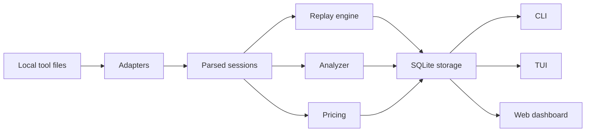

# Architecture

ContextOps uses a replay-first architecture. Adapters normalize tool-specific artifacts into `ParsedSession` objects. The analyzer reads those sessions to detect workflow patterns. The replay engine turns events into chronological frames. Storage persists normalized records in SQLite for CLI, TUI, and web access.

## Adapter Contract

Each adapter exposes:

- `detect()`
- `scan()`
- `parseSession()`
- `extractTimeline()`
- `estimateTokens()`

Adapters must never crash on malformed files. They should attach warnings with confidence scores and continue scanning.

## Storage

SQLite tables:

- `tools`
- `projects`
- `sessions`
- `messages`
- `replay_events`
- `cost_estimates`
- `waste_patterns`
- `scan_runs`
- `model_usage`
- `timeline_nodes`
